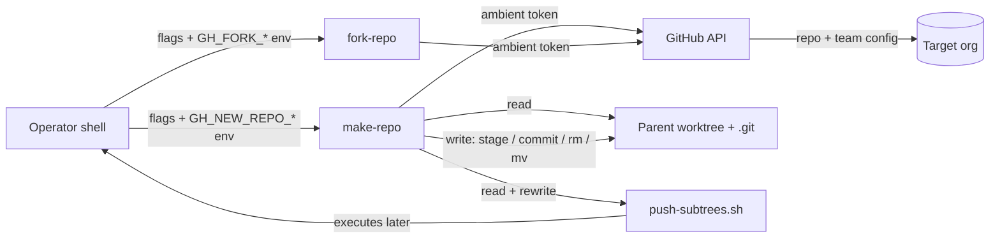

# Threat Model

〚📁:aae44029-3c57-5ac2-ad2b-afeaa316fdb7〛 make-repo THREAT-MODEL :: Attack surface, trust boundaries, and T-001..T-012 risk register

## Overview

`make-repo` / `fork-repo` are operator-run Bash CLIs executed on a developer workstation.
They hold no data at rest and expose no network listener: their entire privilege comes
from the ambient GitHub CLI session (`gh auth status`) and the local filesystem of the
checkout they run in. The crown jewels are therefore **not** this repository's files —
they are (a) the operator's `gh` credential scope, (b) the target organization's repo and
team configuration, and (c) the parent repository's working tree and `.git` metadata,
which the conversion paths move, stage, and re-create.

Three trust boundaries matter:

1. **Workstation → GitHub API** — `gh` presents the operator's stored OAuth token. Every
   action inherits the full scope of that token; these scripts never mint, read, or
   narrow credentials.
2. **cwd → parent repository** — parent detection walks out of the current directory into
   a containing git worktree. Post-create integration then *mutates* that parent
   (stage, commit, `git rm`, `.gitmodules` edit, wrapper script rewrite).
3. **cwd → local git metadata** — subtree and submodule conversion move `.git` aside,
   `rm -rf` module directories, and restore from backups on failure.

Nothing here is a service: there is no ingress, no queue consumer, and no scheduled job.
The realistic adversary is a mistyped or attacker-influenced *invocation* (hostile env
var, hostile repo/dir name, hostile parent repo state), not a remote attacker of a
running system.

## Attack Surface

Entry points are CLI arguments and `GH_NEW_REPO_*` / `GH_FORK_TARGET_ORG*` environment
variables — there is no other input channel. Egress is `gh` (API) and `git` (push, remote
wiring). Local state written: remotes, `.gitmodules`, the parent's `SUBTREES=(...)`
registry, gitlink/subtree commits, and two scratch paths (see `PROJ-SCHEMA.md` §4–§5).

## Vulnerability Register

| ID | Severity | STRIDE | Component | Status |
|----|----------|--------|-----------|--------|
| T-001 | Medium | Elevation of privilege | `--groups` team grant applies `push`/`admin` to org teams with no second confirmation under `--yes` | Partially mitigated — explicit flag only, role allowlist `pull\|push\|admin\|maintain\|triage`, invalid roles skipped |
| T-002 | Medium | Tampering | `--origin` swap renames an existing `origin` and adds a new one; a mis-targeted run re-points a checkout at the wrong repo | Mitigated — swap prompts, `--yes` refuses without `--swap-origin`, `--dry-run` prints `origin_action` |
| T-003 | High | Tampering / DoS (local) | Subtree and submodule conversion `mv` nested `.git` aside and `rm -rf ".git/modules/<path>"`; failure mid-way can strand metadata | Mitigated — backups (`.git` moved aside, `cp -a` to `copy.<dirname>`), restore on failure, `rm -rf "${metadata_backup:?}"` empty-guard |
| T-004 | High | Tampering | Submodule conversion deletes the directory before re-adding it as a submodule | Mitigated — full `cp -a` backup first, content verify after `submodule add`, restore from backup on failure |
| T-005 | Medium | Tampering | Wrapper registration rewrites the parent's tracked `push-subtrees.sh` (`chmod 755`, `mv` over the file) | Mitigated — only when both wrappers exist, requires a clean script, idempotent path check, collision-safe alias, committed separately |
| T-006 | Medium | Tampering (remote) | A push could overwrite upstream history | Mitigated — `safe_push` never force-pushes, refuses diverged histories and behind-HEAD, handles detached HEAD |
| T-007 | Medium | Spoofing / Elevation | All actions run with the operator's full ambient `gh` token; no scoped or per-run credential | Open — accepted (see Residual Risk) |
| T-008 | Low | Tampering | Repo/org/description values from env or argv reach `gh repo create` and `git remote add` | Partially mitigated — all values double-quoted, correct argument positions; no `eval`, no `curl`, no shell re-entry. Argument-position injection (`-`-prefixed value) remains theoretically possible |
| T-009 | Medium | Information disclosure | Default visibility is `private`, but `--public` / `GH_NEW_REPO_PUBLIC*` publish the repo and its full history | Mitigated — private is the built-in default; publishing requires an explicit flag or env |
| T-010 | Medium | Tampering | `--origin` on a submodule edits the superproject `.gitmodules` URL (relative → absolute) and runs `git submodule sync` in other parent worktrees | Partially mitigated — edits only with consent when the file is dirty, aborts on dirty `.gitmodules` under `--yes`, never auto-commits the parent |
| T-011 | Low | Repudiation | Commits created in the parent (subtree metadata, gitlink, wrapper registry) carry the operator's git identity, not the tool's | Accepted — normal git attribution |
| T-012 | Low | Information disclosure | The printed backup path (`copy.<dirname>`) is left on disk for the user to delete | Mitigated — explicit "Remove it when you're satisfied" message; no secrets in the backup beyond what the repo already had |

No Critical entries. No network-facing vulnerability is present because there is no
network-facing component.

## Mitigation Coverage

3 mitigated · 5 partially mitigated · 3 accepted · 1 open (T-007).
The open item is a property of running an operator CLI, not a defect: narrowing it would
mean minting a short-lived scoped token, which would break the "install with `bash`,
`git`, `gh` only" contract (see `PROJ-ARCH.md` § Technology).

## Residual Risk

- **Ambient credential scope (T-007) accepted.** The tools deliberately delegate auth to
  `gh auth status` and never read tokens from env (`PROJ-SCHEMA.md` §1). An operator who
  can run `gh` can already do everything these scripts do; the scripts add convenience,
  not capability.
- **Local destructive conversion (T-003, T-004) accepted with backups.** Data loss is
  bounded by the backup lifecycle; a user who deletes `copy.<dirname>` before verifying
  forfeits that safety net — stated in the tool's own output.
- **No secret handling by design.** No `.envrc` is read, no credential file is opened, no
  token value is printed or logged. Verification is `gh auth status` exit status only.

## Related docs

- Components and data flow: [`PROJ-ARCH.md`](PROJ-ARCH.md)
- Where each boundary-crossing component lives: [`PROJ-LAYOUT.md`](PROJ-LAYOUT.md)
- Data artifacts touched (remotes, `.gitmodules`, registry): [`PROJ-SCHEMA.md`](PROJ-SCHEMA.md)
